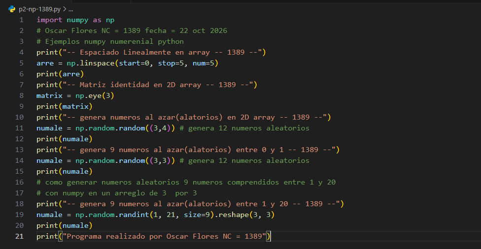
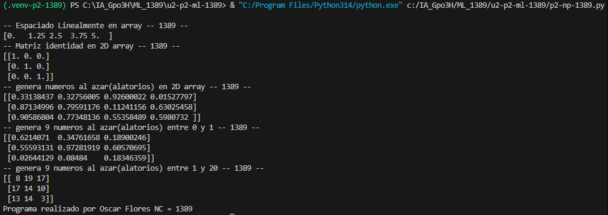

- "start=0:" Indica el valor inicial de la secuencia, es decir, desde dónde comenzarán los números generados.

- "stop=1:" Indica el valor final de la secuencia. Este valor se incluye dentro de los números generados.

- "num=5:" Especifica la cantidad de números que se generarán entre el valor inicial y el final, distribuidos uniformemente.

## que es np.linspace
np.linspace(): Es una función de la biblioteca NumPy que genera una secuencia de números distribuidos uniformemente entre un valor inicial y uno final. Permite especificar cuántos valores se desean obtener dentro de ese intervalo.

## el codigo

## el resultado
